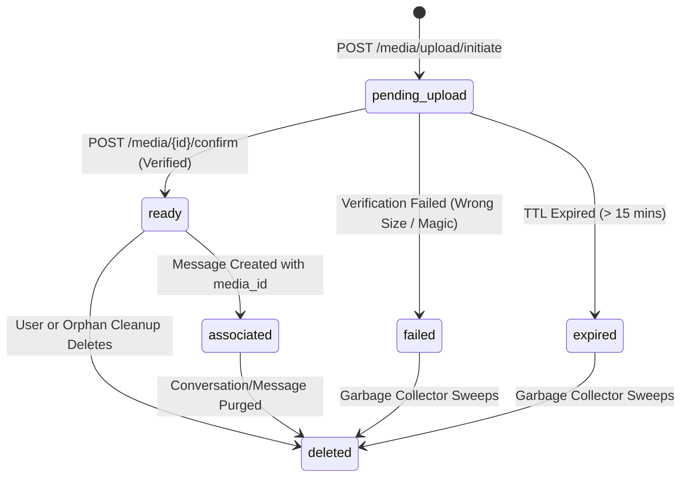

# TOONCHAT — MEDIA STORAGE ARCHITECTURE & PROTOCOL SPECIFICATION
**Document Version:** 1.0.0  
**Phase:** Phase 13.1 — Media Storage Foundation  
**Status:** Architecture Design & Implementation Specification  
**Target Stack:** FastAPI + PostgreSQL 16 + SQLAlchemy 2.0 Async + S3/MinIO/Local Storage + Supabase Auth  

---

## 1. Executive Summary & Design Principles

ToonChat requires a robust, secure, and provider-agnostic media storage subsystem powering:
1. **Chat Media Attachments:** Images (PNG, JPEG, WebP), cartoon voice notes (Ogg, WebM, MP4 audio), and short cartoon videos (MP4, WebM).
2. **Avatar Creator Assets & Stickers:** Custom avatar snapshots and user sticker generation.
3. **Maple Park Ephemera:** Scene snapshots and story media.

### 1.1 Core Architectural Invariants
- **No Binary in PostgreSQL:** Binary file bytes are strictly stored in object storage (MinIO, S3, Cloudflare R2, or local storage during testing). The database stores only authoritative metadata and audit records.
- **Provider-Independent Boundary:** The application interacts solely with `IStorageService`. Neither the database models, REST routers, nor realtime dispatchers couple to AWS SDK or S3 specifics.
- **Random Server-Generated Keys:** Clients never dictate storage paths or bucket prefixes. Keys are server-generated UUIDs/entropy strings: `media/{uploader_id}/{media_id}/{token}.{ext}`.
- **Explicit Two-Phase Upload Verification:** An upload is never marked `ready` merely because the client claims success. The server directly queries the storage layer (`HEAD`/`verify_object`) to confirm presence, actual size, and MIME magic bytes before transitioning state.
- **Strict Authorization on Every Read:** Media access requires active membership in the conversation hosting the parent message. Media owners who leave or are removed from a conversation lose read access to that conversation's media.
- **Short-Lived Ephemeral Signed URLs:** Direct storage URLs are never exposed as long-lived public links. The API issues short-lived presigned URLs (15m for upload, 60m for download) or routes via an authorized streaming proxy.

---

## 2. Storage Service Interface (`IStorageService`)

The storage abstraction is defined in `backend/app/services/storage/base.py`:

```python
from abc import ABC, abstractmethod
from typing import Optional
from pydantic import BaseModel

class UploadTarget(BaseModel):
    storage_key: str
    upload_url: str
    method: str = "PUT"
    headers: dict[str, str] = {}
    expires_in_seconds: int

class StoredObjectMetadata(BaseModel):
    storage_key: str
    size_bytes: int
    content_type: str
    etag: Optional[str] = None
    sha256_hash: Optional[str] = None

class IStorageService(ABC):
    @abstractmethod
    async def create_upload_target(
        self,
        storage_key: str,
        content_type: str,
        max_size_bytes: int,
        expires_in_seconds: int = 900,
    ) -> UploadTarget:
        """Generates an authorized upload target (e.g. presigned PUT URL)."""
        pass

    @abstractmethod
    async def verify_object(
        self,
        storage_key: str,
        expected_size: Optional[int] = None,
        expected_content_type: Optional[str] = None,
    ) -> StoredObjectMetadata:
        """Directly verifies object existence, actual size, and content type in storage."""
        pass

    @abstractmethod
    async def create_download_url(
        self,
        storage_key: str,
        expires_in_seconds: int = 3600,
        filename: Optional[str] = None,
        content_type: Optional[str] = None,
    ) -> str:
        """Generates a short-lived authorized download URL."""
        pass

    @abstractmethod
    async def delete_object(self, storage_key: str) -> bool:
        """Safely removes an object from storage."""
        pass

    @abstractmethod
    async def read_object_bytes(
        self,
        storage_key: str,
        max_bytes: Optional[int] = None,
    ) -> bytes:
        """Reads up to max_bytes from storage for signature verification."""
        pass
```

### 2.1 Provider Implementations
1. **`LocalStorageService` (Default Local Dev & Unit Test Baseline):**
   - Stores files in `data/storage/` on the local disk.
   - Generates HMAC-signed URLs to `/api/v1/media/storage/file/{storage_key}?token=...`.
   - Requires zero external dependencies or cloud credentials.
2. **`S3StorageService` (MinIO Local / AWS S3 / Cloudflare R2 / Supabase S3):**
   - Generates standard AWS SigV4 presigned PUT/GET URLs.
   - Executes `HEAD` and range requests via `httpx` to verify objects.
   - Fully compatible with local MinIO (`http://localhost:9000`).
3. **`MemoryStorageService` (Deterministic Test Double):**
   - In-memory dictionary store for fast, deterministic unit testing without I/O.

---

## 3. Media Upload Lifecycle & State Machine



### 3.1 States
- `pending_upload`: Upload target issued; waiting for client to PUT binary to storage.
- `ready`: Server has verified that object exists in storage, size is within bounds, and file signature matches.
- `failed`: Verification failed (e.g. zero bytes, wrong magic header, corrupted).
- `deleted`: Soft-deleted or purged from storage.

### 3.2 Time-To-Live (TTL) & Expiration Rules
- Upload authorization URLs expire after **15 minutes** (`expires_in = 900s`).
- If an upload is not confirmed within 15 minutes, it is marked `expired`.
- Confirmed media not attached to any message within **24 hours** is swept by the orphan cleanup worker.

---

## 4. Object Key Strategy & MIME Policy

### 4.1 Storage Key Format
Storage keys follow a strict server-allocated hierarchy:
```text
media/{media_type}/{uploader_id}/{media_id}/{random_token}.{ext}
```
Example:
```text
media/image/c1f7f0aa-b54c-47ea-bd56-621aa906e001/8fa8d7a1-3069-4ce3-a006-259fc6c52a32/a9f0e128b4c2.png
```
- Completely opaque to client inputs.
- Prevents path traversal (`../`) and collisions.
- Partitioned by media type and user for predictable lifecycle management.

### 4.2 MIME Allowlist & File Size Quotas

| Media Type | Allowed MIME Types | Extensions | Max File Size | Magic Bytes Checked |
| :--- | :--- | :--- | :--- | :--- |
| `image` | `image/jpeg`, `image/png`, `image/webp` | `.jpg`, `.jpeg`, `.png`, `.webp` | 10 MB | JPEG (`\xFF\xD8\xFF`), PNG (`\x89PNG`), WebP (`RIFF....WEBP`) |
| `voice` | `audio/ogg`, `audio/webm`, `audio/mp4` | `.ogg`, `.webm`, `.m4a`, `.mp4` | 25 MB | Ogg (`OggS`), WebM/Matroska (`\x1A\x45\xDF\xA3`), MP4 (`ftyp`) |
| `video` | `video/mp4`, `video/webm` | `.mp4`, `.webm` | 100 MB | MP4 (`ftyp`), WebM (`\x1A\x45\xDF\xA3`) |

---

## 5. Security & Authorization Rules

### 5.1 Upload Authorization (`POST /api/v1/media/upload/initiate`)
- Caller must be an active, non-suspended user (`require_active_user`).
- Enforces user outstanding upload quota: max 5 active `pending_upload` items per user simultaneously.
- Validates declared MIME type and extension against allowlist.

### 5.2 Upload Confirmation (`POST /api/v1/media/{media_id}/confirm`)
- Caller must be the record's `uploader_id`. Cross-user confirmation is rejected (`403 FORBIDDEN`).
- Media record must currently be in state `pending_upload`.
- `datetime.now(timezone.utc) <= media.expires_at`.
- Direct storage verification:
  1. Object exists at `storage_key`.
  2. $0 < \text{actual\_size} \le \text{max\_size\_bytes}$.
  3. Magic bytes match expected MIME format.
- Idempotent: If already confirmed (`ready`), returns 200 OK with existing metadata.

### 5.3 Download Access (`GET /api/v1/media/{media_id}/url`)
1. **Unattached Media:** Accessible only by `uploader_id` (e.g. while composing).
2. **Attached Media:**
   - Server looks up the associated `Message` referencing `media_id`.
   - Checks that caller is an active member of `message.conversation_id`:
     ```sql
     SELECT 1 FROM conversation_members 
     WHERE conversation_id = :conv_id AND user_id = :caller_id AND left_at IS NULL;
     ```
   - If caller left the conversation or was removed, access is rejected with `404 NOT_FOUND` (indistinguishable from non-existent media for privacy).
   - If message is soft-deleted (`is_deleted = TRUE`), access is rejected.
3. Issues presigned download URL valid for **60 minutes** (`expires_in = 3600s`).

---

## 6. Message & Realtime Integration (Phase 12 Compatibility)

### 6.1 Sending Messages with Media
When sending via WebSocket `chat.send` or REST `POST /messages`:
```json
{
  "type": "chat.send",
  "payload": {
    "conversation_id": "8fa8d7a1-3069-4ce3-a006-259fc6c52a32",
    "client_message_id": "cmsg_10928_f1a2",
    "type": "image",
    "body": "Look at my skate park photo! 🛹📸",
    "media_id": "7b8f9e21-4321-4a1b-90f1-0199e84b2c01"
  }
}
```
Validation in `message_service.allocate_and_insert_message`:
1. If `media_id` is supplied:
   - Query `media` table by `media_id`.
   - Verify `media.uploader_id == sender_id`.
   - Verify `media.status == "ready"`.
   - Verify `media.media_type == payload.type` (or compatible type).
2. Store `media_id` in `messages.media_id`.
3. Set `messages.media_url = f"/api/v1/media/{media.id}/url"` (or dynamic presigned URL).

---

## 7. Configuration & Environment Variables

| Variable | Type | Default | Description |
| :--- | :--- | :--- | :--- |
| `STORAGE_BACKEND` | string | `local` | `local` (filesystem/proxy), `s3` (MinIO/R2/AWS), or `memory`. |
| `LOCAL_STORAGE_DIR` | string | `data/storage` | Local directory for uploaded files. |
| `LOCAL_STORAGE_SECRET` | string | `dev_secret_toonchat_storage` | HMAC signing secret for local storage tokens. |
| `S3_ENDPOINT_URL` | string | `http://localhost:9000` | S3 API endpoint (MinIO or Cloudflare R2). |
| `S3_PUBLIC_ENDPOINT_URL` | string | `http://localhost:9000` | Publicly reachable S3 URL for browser presigned links. |
| `S3_BUCKET_NAME` | string | `toonchat-media` | Object storage bucket name. |
| `S3_ACCESS_KEY` | string | `minioadmin` | S3 Access Key ID. |
| `S3_SECRET_KEY` | string | `minioadmin` | S3 Secret Access Key. |
| `S3_REGION` | string | `us-east-1` | S3 region identifier. |
| `MEDIA_UPLOAD_TTL_SEC` | integer | `900` | Time window to complete upload (15 mins). |
| `MEDIA_DOWNLOAD_TTL_SEC` | integer | `3600` | Download presigned URL lifetime (1 hour). |
